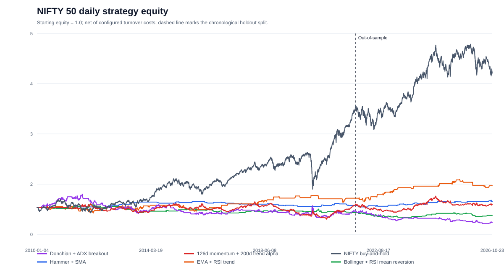
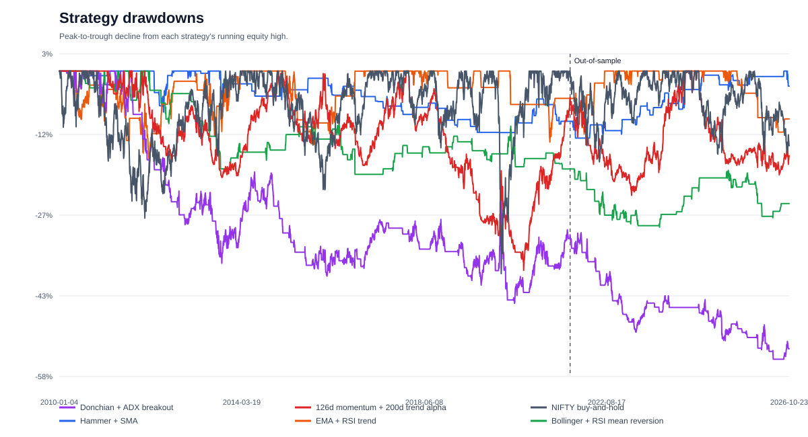
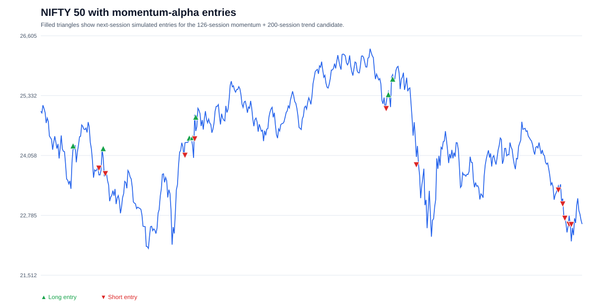

# Candle Pattern TradingView Examples

TradingView Pine Script examples and a dependency-free Python research runner for studying candle patterns and indicator strategies on daily OHLC history.

These are educational, chart-based examples. They do not model a specific futures or options contract, calculate contract quantity from account risk, account for expiry or options Greeks, or establish that a strategy is profitable. Results depend on the chart, timeframe, TradingView data, and Strategy Properties.

## Contents

- [What is implemented](#what-is-implemented)
- [Methodology](#methodology)
- [Repository structure](#repository-structure)
- [Use in TradingView](#use-in-tradingview)
- [Backtest assumptions and limitations](#backtest-assumptions-and-limitations)
- [Validation status](#validation-status)
- [References](#references)

## What is implemented

| Script | Purpose |
|---|---|
| [`strategies/hammer_sma_strategy.pine`](strategies/hammer_sma_strategy.pine) | Long entries on bullish hammers above an SMA; short entries on bearish shooting stars below it. Places a stop beyond the signal candle with an ATR buffer and a target at a configurable risk multiple. |
| [`strategies/ema_rsi_trend.pine`](strategies/ema_rsi_trend.pine) | EMA crossovers confirmed by RSI momentum, with ATR-based stop and target levels. |
| [`strategies/bollinger_rsi_mean_reversion.pine`](strategies/bollinger_rsi_mean_reversion.pine) | Entries on a move back inside a Bollinger Band with an RSI filter, enabled only below a configurable ADX threshold; exits at the band basis or an ATR stop. |
| [`strategies/donchian_adx_breakout.pine`](strategies/donchian_adx_breakout.pine) | Close beyond the prior Donchian channel, filtered by ADX strength and DMI direction, with ATR-based stop and target levels. |
| [`strategies/momentum_alpha_candidate.pine`](strategies/momentum_alpha_candidate.pine) | A 126-session momentum signal gated by a 200-session SMA; enters on regime changes and exits when the regime turns neutral. |
| [`indicators/hammer_range_threshold.pine`](indicators/hammer_range_threshold.pine) | Marks hammer-shaped candles whose body bottom is above a configurable threshold measured down from that candle's high. Provides an indicator alert condition. |

The standalone indicator's threshold is calculated from one candle's high and low. It is not a retracement from a detected market swing. Its original Fibonacci retracement name was therefore changed to describe the actual calculation.

The additional strategies demonstrate different entry hypotheses. The EMA crossover and Donchian breakout approaches follow momentum; the Bollinger/RSI approach attempts to trade a return toward the band mean in lower-ADX conditions. They are alternatives for research, not a combined system or evidence of a trading edge.

## Methodology

### Candle definitions

For each bar:

```text
body       = abs(close - open)
lower wick = min(open, close) - low
upper wick = high - max(open, close)
```

The strategy identifies:

- A **bullish hammer** when the candle closes above its open, its lower wick is at least the configured multiple of the body, and its upper wick does not exceed the configured maximum multiple.
- A **bearish shooting star** when the candle closes below its open, its upper wick meets the long-wick multiple, and its lower wick stays under the configured maximum.

The body used for wick comparisons is floored at one minimum tick, so doji candles do not create a zero denominator. These geometric rules are configurable heuristics, not a universal definition of either pattern.

### Strategy signals and exits

The default SMA period is 25 bars. A bullish hammer is eligible for a long when the close is above the SMA. A bearish shooting star is eligible for a short when the close is below the SMA. Signals are evaluated on confirmed bars, and the example waits until flat before entering.

The initial stop is placed beyond the signal candle's low (long) or high (short), with a configurable ATR buffer. The target is calculated from the signal bar's close using a configurable R multiple. Since the default TradingView strategy execution model generally fills market orders on the next available tick, gaps between signal close and entry can change the realized reward-to-risk ratio. This example does not dynamically size quantity to a fixed account-risk budget.

### Standalone indicator threshold

For `rangeFraction = f`, the indicator calculates:

```text
threshold = high - (high - low) * f
```

It marks a candle when its hammer shape passes the wick rules and the bottom of its real body is at or above this threshold. The optional bullish-color filter applies only to this indicator.

## Repository structure

```text
.
├── README.md
├── LICENSE
├── .gitignore
├── strategies/
│   ├── bollinger_rsi_mean_reversion.pine
│   ├── donchian_adx_breakout.pine
│   ├── ema_rsi_trend.pine
│   ├── hammer_sma_strategy.pine
│   └── momentum_alpha_candidate.pine
├── indicators/
│   └── hammer_range_threshold.pine
├── research/
│   ├── backtest.py
│   ├── data.py
│   ├── download_data.py
│   ├── indicators.py
│   ├── metrics.py
│   ├── plots.py
│   ├── run_backtest.py
│   ├── strategies.py
│   └── tests/
│       └── test_research.py
├── results/
│   ├── equity_curves.svg
│   ├── drawdowns.svg
│   ├── nifty_alpha_entries.svg
│   ├── metrics.csv
│   ├── cost_sensitivity.csv
│   ├── run_metadata.json
│   └── trade_log.csv
└── docs/
    └── methodology.md
```

TradingView supplies the market series when a Pine script is added to a chart. The separate Python backtest uses the local CSV described below.

## Use in TradingView

1. Open a chart for the instrument and timeframe you want to study.
2. Open TradingView's Pine Editor and paste one of the `.pine` files.
3. Save and add the script to the chart. Strategy scripts are independent examples; test one at a time.
4. For a strategy, open **Strategy Tester** and inspect the trades and settings. Set realistic order size, commission, slippage, and margin in **Strategy Properties** for the instrument and venue.
5. For indicator alerts, create an alert using the indicator's **Hammer** condition.

To reproduce a TradingView result, record the symbol, exchange/data feed, timeframe, date range, chart type, script inputs, and Strategy Properties.

## Python backtest and charts

The research runner compares the rule sets on daily NIFTY 50 index data. It downloads Yahoo Finance's public chart history for `^NSEI`; this is a convenience source, not an official exchange feed. The current working copy's [downloaded CSV](data/raw/nifty50_daily.csv) and metadata stay in ignored `data/raw/`, so they are available locally but are not committed; each user can retrieve a fresh copy.

Python 3.10 or newer is required. The backtest, indicators, CSV handling, tests, and SVG plots use only the Python standard library.

```powershell
python -m research.download_data --symbol '^NSEI' --start 2010-01-01
python -m research.run_backtest --data data/raw/nifty50_daily.csv --out results --cost-bps 5
python -m unittest discover -s research/tests -v
```

The runner calculates entries at a bar close and executes them at the next session open. It checks daily OHLC for stop and target fills; if both are touched in one bar, it assumes the stop was hit first. The configured cost is charged per one-way notional turnover. This is an underlying-index research simulation, not a derivatives contract backtest.

The report includes an in-sample period and a later chronological out-of-sample period. Parameters are fixed in advance and are not optimized on the holdout. Metrics include CAGR, annualized volatility, zero-risk-free Sharpe, maximum drawdown, benchmark-relative beta/alpha and information ratio, trade statistics, exposure, and turnover. `cost_sensitivity.csv` repeats the out-of-sample comparison at 0, 5, and 10 basis points per side. Tables, logs, and charts are saved under `results/`.

### Latest checked run

The checked run used 4,128 daily NIFTY 50 index bars from 2010-01-04 through 2026-10-23. The holdout starts 2021-10-19; the run used an estimated 5 bps per side and excluded the first 200 bars for indicator warm-up. These are price-index results and do not include dividends or instrument-specific futures/options costs.

| Strategy | OOS CAGR | NIFTY buy-and-hold CAGR | OOS Sharpe | OOS max drawdown | Regression alpha (annual) | Trades |
|---|---:|---:|---:|---:|---:|---:|
| Hammer + SMA | 1.77% | 4.10% | 0.46 | -3.61% | 1.71% | 26 |
| EMA + RSI trend | 4.59% | 4.10% | 0.68 | -11.58% | -0.02% | 19 |
| Bollinger + RSI mean reversion | -1.67% | 4.10% | -0.29 | -13.56% | -1.70% | 35 |
| Donchian + ADX breakout | -7.24% | 4.10% | -0.73 | -34.62% | -6.76% | 42 |
| 126d momentum + 200d trend candidate | -0.17% | 4.10% | 0.04 | -19.69% | -0.32% | 41 |

The momentum candidate did **not** outperform NIFTY buy-and-hold on out-of-sample CAGR, Sharpe, or regression alpha, and its maximum drawdown was deeper. The EMA/RSI result was modestly higher on CAGR and Sharpe in this one holdout, but its regression alpha was approximately zero. The holdout is exploratory: it was inspected during implementation/debugging, so it is not a blind confirmatory test. No durable alpha claim is supported by these results. The Pine alpha script uses TradingView's default fixed quantity; the Python candidate applies volatility targeting, so their position sizes and backtest results differ.

### Visuals

The equity and drawdown charts cover the full data range; the dashed marker shows where the out-of-sample period starts.





This chart marks the momentum candidate's simulated entry sessions on the NIFTY price series. Green triangles are long entries; red triangles are short entries.



Full outputs: [`metrics.csv`](results/metrics.csv), [`cost_sensitivity.csv`](results/cost_sensitivity.csv), [`trade_log.csv`](results/trade_log.csv), and [`run_metadata.json`](results/run_metadata.json).

## Backtest assumptions and limitations

- The scripts operate on the chart's OHLC values. They do not select or validate an options or futures contract.
- The Python simulation uses NIFTY 50 price-index history. It does not model option payoffs, futures rolls, contract multipliers, margin, funding, portfolio limits, dividends, or actual fill slippage. The assumed 5 bps per-side cost is not a quoted fee schedule.
- The strategy provides illustrative entries and exits only. It does not include contract selection, expiry handling, options Greeks, funding, borrow costs, margin liquidation, portfolio constraints, or account-risk-based position sizing.
- The indicators are standard lagging transformations of historical price. EMA/RSI, Bollinger/RSI/ADX, and Donchian/DMI/ADX combinations are example rules whose behavior depends on market regime and parameter choices.
- Commission and slippage should be configured for the actual instrument; default tester settings may omit meaningful trading costs.
- Standard OHLC bars are assumed. Synthetic chart types can produce prices that are not directly tradable.
- Historical backtests are simulations and do not establish future performance. The included run is one fixed-parameter holdout check, not a walk-forward test across multiple market regimes or an estimate of deployable returns.

## Validation status

The Python research pipeline was run on the downloaded NIFTY 50 bars and its automated unit tests pass. Pine Script compilation and Strategy Tester execution still require TradingView and a selected chart; they were not available here, so Pine platform compilation remains unverified. The Python run does not exactly reproduce TradingView's broker emulator.

## References

- [TradingView Pine Script v6 documentation](https://www.tradingview.com/pine-script-docs/)
- [TradingView strategy concepts and order execution](https://www.tradingview.com/pine-script-docs/concepts/strategies/)
- [TradingView strategy properties](https://www.tradingview.com/support/solutions/43000628599-strategy-properties/)
- [TradingView alert documentation](https://www.tradingview.com/pine-script-docs/concepts/alerts/)
- [Yahoo Finance NIFTY 50 historical prices](https://finance.yahoo.com/quote/%5ENSEI/history/)
- [NSE NIFTY 50 index overview](https://www.nseindia.com/static/products-services/indices-nifty50-index)
